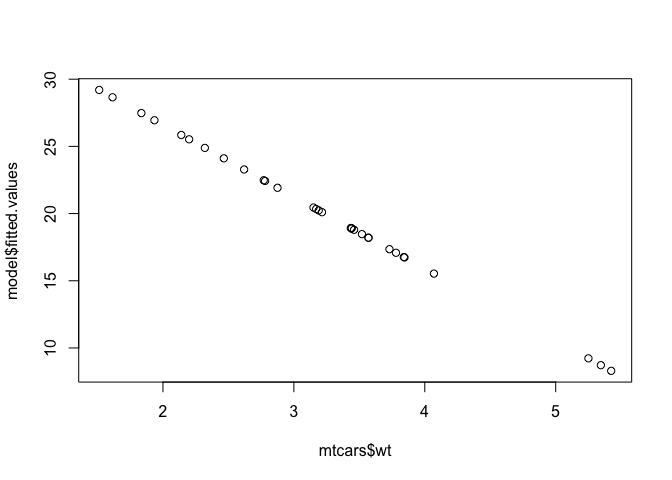

<!-- README.md is generated from README.qmd. Please edit that file -->

# lrmodel

<!-- badges: start -->

[](https://github.com/diggsm/bios625_hw4/actions/workflows/R-CMD-check.yaml)
[](https://app.codecov.io/gh/diggsm/bios625_hw4)
<!-- badges: end -->

The lrmodel package was designed to re-implement the base R function
`lm()` and generate results from a linear regression model.

## Installation

You can install the development version of lrmodel from
[GitHub](https://github.com/) with:

``` r
# install.packages("pak")
pak::pak("diggsm/bios625_hw4")
```

## Usage

Below are example of how to use the `lrmodel` function to fit a simple
linear regression model and explore the model results.

``` r
library(lrmodel)

# Fitting a simple linear regression model
model <- lrmodel(mpg ~ wt, data = mtcars)
model$coefficients
#> (Intercept)          wt 
#>   37.285126   -5.344472

model$call
#> lrmodel(formula = mpg ~ wt, data = mtcars)

summary(model$residuals)
#>    Min. 1st Qu.  Median    Mean 3rd Qu.    Max. 
#> -4.5432 -2.3647 -0.1252  0.0000  1.4096  6.8727

model$rank
#> [1] 2
```


