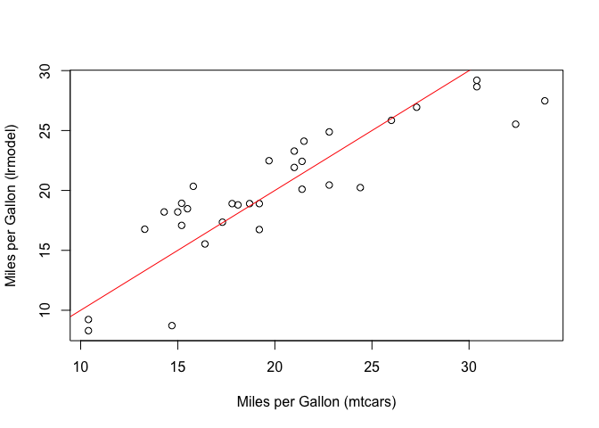
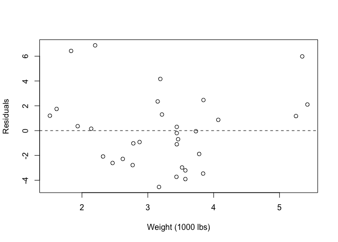

<!-- README.md is generated from README.qmd. Please edit that file -->

# lrmodel

<!-- badges: start -->

[](https://github.com/diggsm/bios625_hw4/actions/workflows/R-CMD-check.yaml)
[](https://app.codecov.io/gh/diggsm/bios625_hw4)
<!-- badges: end -->

The `lrmodel` package was designed to re-implement the base R functions
`lm()` and `summary()` for linear regression model objects. The package
contains two core functions functions: `lrmodel()` generate results from
a linear regression model, and `lrmodel_summary()` produces a formatted
summary of the results.

## Installation

You can install the development version of lrmodel from
[GitHub](https://github.com/) with:

``` r
# install.packages("pak")
pak::pak("diggsm/bios625_hw4")
```

## Usage

Below are examples of how to use the `lrmodel` package to fit a simple
linear regression model and explore the results.

``` r
library(lrmodel)

# Fitting a simple linear regression model
model <- lrmodel(mpg ~ wt, data = mtcars)
#> Call:
#> lrmodel(formula = mpg ~ wt, data = mtcars)
#> 
#> Coefficients:
#> (Intercept)          wt 
#>   37.285126   -5.344472
model$coefficients
#> (Intercept)          wt 
#>   37.285126   -5.344472

model$call
#> lrmodel(formula = mpg ~ wt, data = mtcars)

summary(model$residuals)
#>    Min. 1st Qu.  Median    Mean 3rd Qu.    Max. 
#> -4.5432 -2.3647 -0.1252  0.0000  1.4096  6.8727

model$rank
#> [1] 2

# View a formatted summary of the linear regression model results
lrmodel_summary(model)
#> Call:
#> lrmodel(formula = mpg ~ wt, data = mtcars)
#> 
#> Residuals:
#>       Min.    1st Qu.     Median    3rd Qu.       Max. 
#> -4.5431513 -2.3647089 -0.1251956  1.4095613  6.8727113 
#> 
#> Coefficients:
#>              Estimate Std. Error   t value     Pr(>|t|)
#> (Intercept) 37.285126   1.877627 19.857575 8.241799e-19
#> wt          -5.344472   0.559101 -9.559044 1.293959e-10
#> 
#> Residual standard error: 3.045882 on 30 degrees of freedom
#> (0 observations deleted due to missingness)
#> Multiple R-squared: 0.7528328 ,  Adjusted R-squared: 0.7445939 
#> F-statistic: 91.37533 on 1 and 30 DF, p-value: 1.293959e-10
```

``` r
# Plotting the fitted values
plot(
  x = mtcars$mpg, y = model$fitted.values,
  xlab = "Miles per Gallon (mtcars)",
  ylab = "Miles per Gallon (lrmodel)"
  )
abline(a = 0, b = 1, col = "red")
```



``` r
# Plotting the residuals
plot(
  x = mtcars$wt,
  y = model$residuals,
  xlab = "Weight (1000 lbs)",
  ylab = "Residuals"
)
abline(a = 0, b = 0, lty = 2)
```


